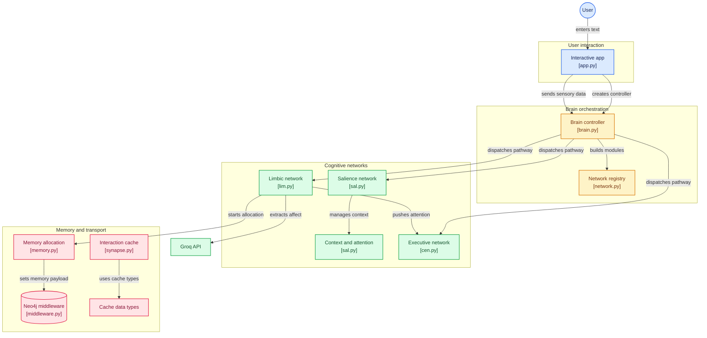

## 📖 Overview

Syneuro is a Neuro-Symbolic Affective-Computing Framework designed to simulate complex emotions via Python
## Architecture

* **`SALNetwork` (Salience):** The core router. It actively monitors incoming telemetry and decides whether the emotion should be in a resting state or active.
* **`CENetwork` (Central Executive):** Handles high-level reasoning, complex problem solving, tool execution, and goal-directed behavior influenced by emotion.
* **`LIMNetwork` (Limbic):** The affective state machine powered by a quantum-inspired expressions. Responsible for the internal mood, emotional responses, and assigns emotional weight to memory formation randomness.

## Diagram

